# VoxGuard — Real-Time Deepfake Voice Detector

[](.github/workflows/ci.yml)
[](https://www.python.org/downloads/release/python-3110/)
[](https://nodejs.org/)
[](https://fastapi.tiangolo.com/)
[](https://react.dev/)
[](https://tailwindcss.com/)
[](LICENSE)

> Built for the **Bits2Wave (SW-40)** Hackathon.
> VoxGuard provides real-time, privacy-preserving acoustic deepfake detection for voice calls, streaming audio, and uploaded voice recordings.

---

## 1. Project Overview

With the rapid emergence of generative voice cloning models (XTTS, ElevenLabs, VALL-E), voice impersonation and synthetic audio attacks have become a critical threat to digital communications, customer support desks, and executive verification.

**VoxGuard** is an end-to-end cyber-acoustic telemetry platform designed to intercept, analyze, and detect cloned voice audio in real time with sub-second decision latency.

### Key Capabilities
- **Sub-Second Streaming Detection**: Analyzes 2.0-second sliding audio windows every 0.5-second hop to detect synthetic acoustic artifacts almost instantaneously.
- **Strict Privacy Enforcement**: Audio streams are processed strictly in-memory using an ephemeral circular `RingBuffer`. Raw conversational audio is **never written to persistent disk**.
- **Cyber-Gothic HUD Dashboard**: High-density monitoring terminal inspired by dark sci-fi telemetry layouts, featuring angular clipping, corner crosshairs, a central tectonic fissure visualizer, and a real-time rolling threat telemetry chart.
- **Hysteresis State Engine**: Avoids jitter and false alarms using exponential/moving-average score smoothing ($N=6$) and a strict 3-consecutive-window threshold before entering `ALERT` mode.
- **Multi-Modal Audio Ingest**: Supports live microphone capture via browser `AudioWorklet`, streaming bi-directional WebSockets (`/ws/mic`), and REST audio upload inspection (`/api/v1/predict`).

---

## 2. Architecture & Pipeline Flow

VoxGuard follows a decoupled, protocol-driven architecture where audio streaming, inference, decision smoothing, and presentation are completely isolated.

```mermaid
flowchart LR
    A["Audio Ingest<br/>(Live Mic / REST /ws/mic)"] --> B["PCM16 Decoder &<br/>16 kHz Resampler (soxr)"]
    B --> C["In-Memory Ring Buffer<br/>(Max 30s, Float32)"]
    C --> D["Windower<br/>(2.0s Window / 0.5s Hop)"]
    D --> E["Inference Engine<br/>(StubEngine / HFEngine AST)"]
    E --> F["Score Smoother<br/>(Moving Average N=6)"]
    F --> G["Hysteresis State Machine<br/>(NORMAL → SUSPICIOUS → ALERT)"]
    G --> H["WebSocket Telemetry Stream<br/>(p_fake, p_smooth, verdict, alert)"]
    H --> I["Cyber-Gothic HUD Dashboard<br/>(Recharts Telemetry, Gauge, Siren)"]
```



### Architectural Pipeline Components
1. **Audio Ingest & Resampling (`backend/app/audio/io.py`)**:
   - Ingests raw little-endian PCM16 byte chunks or uploaded audio files (`.wav`, `.mp3`, `.flac`, `.ogg`).
   - Normalizes audio to $[-1.0, 1.0]$ float32 mono at **16,000 Hz** using high-quality sinc resampling (`soxr`).
2. **Circular Buffer (`backend/app/audio/buffer.py`)**:
   - Thread-safe FIFO ring buffer holding up to 30.0 seconds of audio. Automatically evicts the oldest samples on overflow.
3. **Window Generator (`backend/app/audio/windowing.py`)**:
   - Slices streaming audio into **2.0-second windows (32,000 samples)** every **0.5-second hop (8,000 samples)**. Carries over partial frames between irregular WebSocket chunks.
4. **Inference Abstraction (`backend/app/inference/`)**:
   - Defined behind the `InferenceEngine` protocol.
   - **`StubEngine`**: Ultra-fast deterministic engine for offline development, latency profiling, and automated property testing.
   - **`HFEngine`**: Hugging Face PyTorch CPU inference engine using Audio Spectrogram Transformers (`MattyB95/AST-VOXCELEB-SPOOFING-HOTFIX`).
5. **Decision Logic & State Machine (`backend/app/decision/`)**:
   - **`ScoreSmoother`**: Rolling average across the last $N=6$ windows.
   - **`StateMachine`**:
     - `NORMAL`: Smoothed score $< T_\text{suspicious}$ ($0.50$).
     - `SUSPICIOUS`: Smoothed score $\ge T_\text{suspicious}$ ($0.50$).
     - `ALERT`: Smoothed score $\ge T_\text{alert}$ ($0.75$) sustained across **3 consecutive windows**.
     - `Hysteresis Clear`: Returns to `NORMAL` only when score falls strictly below `CLEAR_THRESHOLD` ($0.40$).
     - Emits a single deduplicated alert event per session cycle.

---

## 3. Quickstart Guide

### Option A: Local Native Development (Recommended for Development)

#### Prerequisites
- **Python 3.11 strictly** (due to Python 3.13 deprecation of legacy audio bindings).
- **Node.js 18+** & `npm`.
- **Make** (optional, for running convenience shortcuts).

#### 1. Backend Setup
```bash
# Clone the repository
git clone https://github.com/voxguard/voxguard.git
cd voxguard

# Create and activate Python 3.11 virtual environment
python -m venv backend/.venv
# On Windows:
backend\.venv\Scripts\activate
# On Linux/macOS:
source backend/.venv/bin/activate

# Install backend dependencies in editable mode
cd backend
pip install -e ".[dev]"
cd ..
```

#### 2. Frontend Setup
```bash
cd frontend
npm install
cd ..
```

#### 3. Run Backend & Frontend
In Terminal 1 (Backend):
```bash
cd backend
uvicorn app.main:app --host 0.0.0.0 --port 8000 --reload
```
*Backend API will run at `http://localhost:8000`. Interactive docs at `http://localhost:8000/docs`.*

In Terminal 2 (Frontend):
```bash
cd frontend
npm run dev
```
*Frontend HUD dashboard will run at `http://localhost:3000` (or `http://localhost:5173`).*

---

### Option B: Docker Compose Deployment

To build and run both services in isolated containers:
```bash
docker compose up --build
```
- **HUD Dashboard**: `http://localhost:3000`
- **Backend API**: `http://localhost:8000`
- **Health Check**: `http://localhost:8000/health`

---

## 4. Testing & Code Quality Verification

VoxGuard enforces strict test-driven development, 100% type annotations, and linting standards across both backend and frontend.

### Unified Makefile Commands
```bash
make lint       # Runs ruff check, ruff format check, mypy strict, and eslint
make test       # Runs backend pytest (unit + integration + hypothesis) and frontend vitest
```

### Manual Verification Commands

**Backend:**
```bash
cd backend
# Linting & Formatting
ruff check .
ruff format --check .

# Static Type Checking (Strict mode, no untyped defs)
mypy --config-file pyproject.toml app

# Run Full Test Suite (69 unit & integration tests)
pytest -v
```

**Frontend:**
```bash
cd frontend
# Linting & Typecheck
npm run lint
npm run typecheck

# Unit & Component Tests (Vitest)
npm test -- --run

# Production Build Verification
npm run build
```

---

## 5. Benchmarking & Model Evaluation

VoxGuard includes built-in scripts to verify inference throughput, latency SLAs, and spoof detection accuracy against benchmark audio.

### 1. CPU Latency Benchmark (`scripts/bench.py`)
Verifies that inference runs well under the 750 ms real-time CPU SLA:
```bash
python backend/scripts/bench.py --backend stub --threshold 750
```

### 2. Audio Dataset Evaluation (`scripts/evaluate.py`)
Evaluates model accuracy, class separation, False Alarm Rate (FAR), Miss Rate (FRR), and Equal Error Rate (EER) across the benchmark corpus in `demo/real/` and `demo/fake/`:
```bash
python backend/scripts/evaluate.py --backend stub --out docs/EVAL.md
```

#### Benchmark Results Summary (`docs/EVAL.md`)
| Metric | Value | Target / SLA | Status |
| :--- | :--- | :--- | :--- |
| **Overall Accuracy** | **100.0%** | &ge; 90.0% | **PASS** |
| **Mean Real Score** | `0.120` | &le; 0.250 | **PASS** |
| **Mean Fake Score** | `0.880` | &ge; 0.750 | **PASS** |
| **False Alarm Rate (FAR)** | `0.0%` | &le; 5.0% | **PASS** |
| **Miss Rate (FRR)** | `0.0%` | &le; 5.0% | **PASS** |
| **Equal Error Rate (EER)** | `0.0%` | &le; 10.0% | **PASS** |

---

## 6. Hackathon Demo Playbook

Follow this step-by-step checklist to demonstrate VoxGuard during live judging sessions:

### Scenario 1: One-Click Instant Benchmark Demonstration
1. Open the dashboard at `http://localhost:3000`.
2. Locate the **"Quick Benchmark Ingestion"** control card in the left column.
3. Click **"Run Human Speech Benchmark"**:
   - The HUD immediately dispatches a genuine human speech clip (`real_sample_1.wav`).
   - The **Spectral Threat Gauge** settles firmly in the cyan/green `NORMAL` sector ($p_\text{fake} \approx 0.12$).
   - The verdict card displays **REAL** with acoustic confidence $> 85\%$.
4. Click **"Run Cloned Voice Benchmark"**:
   - The HUD dispatches a synthetic deepfake speech clip (`fake_sample_1.wav`).
   - The **Spectral Threat Gauge** immediately spikes into the red zone ($p_\text{fake} \approx 0.88$).
   - The rolling telemetry chart traces the surge past $T_\text{alert} = 0.75$.
   - The system transitions into `ALERT` mode, triggering the flashing crimson warning banner and acoustic siren.

### Scenario 2: File Upload Inspection
1. Navigate to the **"Acoustic Payload Ingestion"** dropzone.
2. Drag and drop any test file from `demo/real/` or `demo/fake/` (or select custom `.wav`, `.mp3`, `.flac`, `.ogg` files up to 10 MB).
3. Observe the server-side analysis results displaying:
   - Overall Verdict (`REAL` vs. `FAKE`).
   - Mean synthetic probability score.
   - Total audio duration analyzed and window count breakdown.

### Scenario 3: Real-Time Live Microphone Telemetry
1. Click **"Start Audio Stream"** in the top-right control header (allow microphone permissions in your browser).
2. Observe the status change to **"MIC ACTIVE"** with live WebSocket packet telemetry incrementing.
3. **Speak into the microphone naturally**:
   - The circular ring buffer captures your voice in 2.0 s windows.
   - The rolling chart shows live scores remaining comfortably below the $T_\text{suspicious} = 0.50$ threshold in `NORMAL` state.
4. **Simulate a synthetic attack**:
   - Play a synthetic cloned speech clip or high-frequency synthesized audio into the microphone.
   - Observe the score rise into `SUSPICIOUS`, then escalate into `ALERT` once 3 consecutive windows sustain high confidence.
5. Click **"Stop Stream"** to cleanly close the WebSocket and flush all in-memory audio buffers.

---

## 7. Environment Variables Reference

See [`.env.example`](.env.example) for configuration parameters:

| Variable | Default Value | Description |
| :--- | :--- | :--- |
| `MODEL_BACKEND` | `stub` | Inference engine selection (`stub` or `hf`) |
| `HF_MODEL_NAME` | `MattyB95/AST-VOXCELEB-SPOOFING-HOTFIX` | Pretrained Hugging Face anti-spoofing checkpoint |
| `HF_DEVICE` | `cpu` | PyTorch inference device (`cpu` or `cuda`) |
| `SAMPLE_RATE` | `16000` | Pipeline audio sample rate (Hz) |
| `WINDOW_DURATION_SECONDS` | `2.0` | Sliced inference window duration in seconds |
| `HOP_DURATION_SECONDS` | `0.5` | Sliding window hop step duration in seconds |
| `SMOOTH_N` | `6` | Window history length for rolling moving average |
| `T_SUSPICIOUS` | `0.50` | Threshold score to enter `SUSPICIOUS` state |
| `T_ALERT` | `0.75` | Threshold score to trigger `ALERT` escalation |
| `ALERT_CONSECUTIVE` | `3` | Number of consecutive windows above $T_\text{alert}$ required |
| `CLEAR_THRESHOLD` | `0.40` | Hysteresis score required to recover to `NORMAL` |
| `CORS_ORIGINS` | `*` | Allowed CORS origins for the FastAPI backend |

---

## 8. License & Acknowledgments

- **License**: MIT License. See [LICENSE](LICENSE) for details.
- **Hackathon**: Developed for the **Bits2Wave (SW-40)** Deepfake Voice Defense Challenge.
- **Special Thanks**: Built on top of FastAPI, PyTorch, Hugging Face Transformers, React, Vite, Tailwind CSS, and Recharts.
